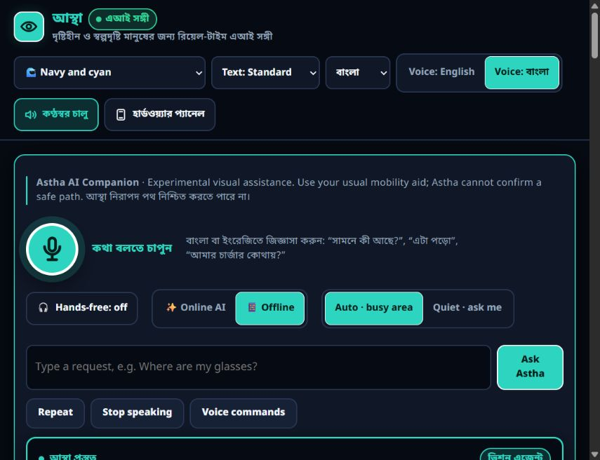

# ASTHA verification and delivery

Date: 9–11 October 2026. These are release candidate checks, not production approval.

The source repository is mysunatislam/astha; the requested astha-live repository contains generated static assets. Both candidates use a separate production/stabilize-2026-10-09 review branch, pushed after explicit public-payload approval. The separately approved Supabase setup created the private six-table schema and restricted login; its password and connection configuration were provisioned securely. Existing public.asha_objects and personal rows remain untouched. No main branch, HTTP hosting or store account was changed.

## Recorded checks

| Check | Result | Limit |
| --- | --- | --- |
| Original web build and existing agent client/server suites | Passed | Simulated agent behavior; no visual accuracy proof. |
| Final npm run check | Passed: 177 regressions plus both existing suites | Reproducible generation (two runs), all JS/generated inline syntax, isolated HTTP/database and mocked frontend/provider/storage tests; actual pg-pool initialization lifecycle tested with transport fixtures. |
| Root/server locked dependency installs | npm ci passed | Local runtime Node 24.13.0. |
| Root and server npm audit | 0 reported advisories each | Checked 11 October after Postgres dependency installation; excludes CDN/model/native SDK assets and future advisories. |
| Workflow syntax and whitespace | All three workflows pass actionlint 1.7.12, YAML parsing and git diff --check | Fixed actual GitHub rejection of runner.temp in job-level env. Native jobs remain unrun. |
| Hosted source CI | Push/PR checks passed for original review head 3acd000 | Final follow-up commit checks are recorded separately in delivery-status; no deployment. |
| Maira live contract | One text request and one synthetic printed-image request passed with Bangla/English fields | Keys were held in memory only; no camera/private image. Actual accuracy, privacy policy/profile guarantees and production availability remain unverified. |
| Supabase storage/API fixtures | Local Postgres adapter/schema/RLS/atomic-write and actual HTTP PGlite tests pass; async SQLite API persistence/isolation/failure tests pass | Isolated fixtures verify API behavior; hosted authenticated account CRUD/import and deployment remain unverified. |
| Approved Supabase setup and actual driver connection | Six private tables and restricted SCRAM login; pg 8.23.1 authenticated with verified TLS 1.3 and passed read-only schema/role/index checks | No personal rows read or account data written/imported; the existing public.asha_objects remains untouched. |
| Hosted statement timeout | Two distinct session-pool connections each report 10s; server cancels SELECT pg_sleep(11) with 57014 | Corrects observed 2min default through awaited initialization; port 6543 rejected. No global database timeout changed. |
| Actual Express API startup | Production local configuration loads, health 200/no-store reports Maira configured, unauthenticated memory 401; shutdown handler exits 0 | Loopback HTTP startup and hosted storage readiness only; no Maira request, authenticated hosted CRUD, HTTPS deployment or device flow. |
| Private configuration and test isolation | Git-ignored/untracked environment with protected owner/SYSTEM/Administrators ACL; injected fixture settings override private configuration | Maira keys, local JWT and restricted database password stay private. No provider/database requests by this configuration probe. |
| Supabase advisors | Security INFO for existing public.asha_objects without policies; performance INFO for five new unused indexes | Keep unrelated data inaccessible and new tenant indexes until representative workload evidence; platform patch baseline needs review. See supabase-integration.md. |
| Speech privacy and resources | POST/auth/origin/bounds/no-store, local fallback, disconnect/Stop, deadline, XML escaping and cleanup regressions pass | Mocked provider only; legacy cached GET clients need refreshed shell/local voice. No generated-speech cache remains. |
| Local hazard fallback | Six regressions pass with cloud configured/unavailable/failing and existing local evidence guards | Actual accuracy, false-warning rate and physical movement safety unverified. |
| Capacitor Android sync | Passed with final web assets | Actual installer-exclusion hook also passed with a disposable archive fixture; Android/iOS fixture tests pass. |
| Android testDebugUnitTest lintDebug assembleDebug | Passed | Existing unit suite has 1 arithmetic test. Lint: 0 errors, 15 warnings. No device instrumentation; authorized ADB discovery found zero attached test devices. |
| assembleRelease bundleRelease without credentials | Expected rejection at validateReleaseInputs | No signed release APK or AAB produced. |
| Browser local note / reload / sign-out | Observed note saved locally, persisted after reload, and absent in fresh guest | Synthetic fixture; no real user data or cloud provider result. |
| Browser interface/voice languages | English UI switch/persistence retained Bangla voice selection; Bangla UI restored | Complete translation and physical Bangla synthesis unverified. |
| Browser model initialization | Quantized YOLO failed with unsupported ConvInteger(10); existing COCO-SSD fallback initialized | Only initialization observed; actual detector output/accuracy and offline cold reopen unverified. |
| iOS / IPA / TestFlight | Not run | Windows host; macOS/Xcode and owner signing/account credentials needed. |
| Container readiness and image gate | Three local health-probe tests pass; real Docker build/runtime smoke is added to source CI | Official base digest verified/pinned. Docker unavailable locally; hosted smoke outcome recorded in delivery evidence. HTTPS hosting, CA mount, backups and alerts remain open. |
| Request monitoring/privacy | Nine regressions pass, including real HTTP failures and interrupted responses | Generated IDs, fixed counters and optional bounded failure logs; host alerts, retention and external monitoring remain unconfigured. |
| Authenticated hosted storage smoke | Seven checks passed using two temporary synthetic accounts with exact guarded cleanup | Existing personal rows unchanged; no Maira request. Hosted signup, agent/provider, HTTPS/client and real-device flows unverified. |

### Follow-up checks, 13 October 2026

| Check | Result | Limit |
| --- | --- | --- |
| `npm run check` after the account-data, input-bound and interface-language work | Passed: 211 regressions plus both existing agent suites; build reproducible | Same isolated SQLite, PGlite and mocked-provider boundaries as above. Run with the Android NDK's Python 3.11.4 through `ASTHA_PYTHON`; the Store Python alias could not be started on this host. |
| Account export, deletion, guest registration, retention and input bounds | Real HTTP against disposable SQLite, and against PGlite PostgreSQL with the reviewed migration, restricted role and RLS | Synthetic accounts only. Not run against hosted Supabase; no schema change was needed, so the provisioned v1 schema is unchanged. |
| Root and server `npm audit` | 0 reported advisories each | Checked 13 October; same exclusions as above. |
| Browser check on `http://localhost:8787` | Bangla and English interface switch across static text, labels, ARIA attributes and state labels; sign-in dialog open, Escape and focus return; a guest registering in place and keeping its memory; export contents; face and voice removal; wrong-PIN refusal; deletion followed by a clean restart as a new guest | Desktop Chromium with a synthetic account and disposable database. The export was captured in the page instead of saved. No camera, microphone, speech output, screen reader or phone was involved. |
| Bangla wording | Written for this change | Not reviewed by a Bangla speaker or tested with TalkBack or VoiceOver. |

Local versions: Node 24.13.0, Python 3.12.14, Java 21.0.9, Gradle 8.14.3, Android API/build-tools 36. Workflows pin Node 24.21.0, Python 3.11.9, Ubuntu 24.04, explicit Android SDK packages and Xcode 26.3. The pinned Linux/Node/Python source CI environment passed at 3acd000; hosted native/iOS environments remain unverified.

The final Android ZIP must contain the exact generated index.html, backend.js, config.js and sw.js and no archived downloads/astha.apk; checksums are supplied with the debug artifact. This debug APK is for verification and cannot be presented as the Google Play release.

## Reproduce checks

From the source checkout, with the specified runtimes available:

```text
npm ci
npm ci --prefix server
npm run check
npm audit --audit-level=moderate
npm audit --prefix server --audit-level=moderate
npx cap sync android
cd android
gradlew testDebugUnitTest lintDebug assembleDebug
```

Use ./gradlew on macOS/Linux and gradlew.bat on Windows. Set JAVA_HOME, ANDROID_HOME and ASTHA_PYTHON for local tool locations when necessary. Use a task-local GRADLE_USER_HOME (this run uses work/astha/.gradle-cache) to reproduce native builds with the existing cache. Signed release commands require the external version/signing inputs in native-release.md; never use the exposed historical key. The hosted native workflow produces reviewed artifacts and does not publish a GitHub Release or submit to a store.

## Review and resume

The bundle prerequisites are source base decb73e57edc33d1776074560806a609d096fdaf and distribution base 48162d5318f9dd7680ba1d465eabfc4fa339ce7b. Fetch the appropriate original repository first, verify its corresponding bundle, then fetch the bundled production/stabilize-2026-10-09 ref into a new review branch. Do not force-reset an existing checkout. The snapshot ZIP is a convenience copy of the final source, with no node_modules, keystores, databases, archived APK or Git history.

Review source-audit-and-release-plan.md for priorities, every finding's files/root cause/minimal fix/status, and all seven release workstreams. native-release.md contains owner signing and store gates. Provider/JWT/signing credential recovery, persistent HTTPS backend configuration, unsupported model/runtime work, full privacy/deletion policy and bilingual accessibility/device tests remain release blockers.

The GitHub connector returned HTTP 403 for branch/PR creation. After explicit public-payload approval, existing Git credentials pushed both branches and created [source draft #1](https://github.com/mysunatislam/astha/pull/1) and [distribution draft #1](https://github.com/mysunatislam/astha-live/pull/1). Credentials were used only in process memory and were not displayed or saved. Final publication/CI status is recorded in delivery-status.md; local bundles remain usable independently of connector permissions.




## Provider and storage continuation

The production example selects Maira and Supabase, with blank server-only credentials. Protected local server configuration now contains the authorized Maira keys, newly generated local JWT and restricted Supabase connection with trusted CA; no deployed signing secret was rotated. SQLite remains the explicit/default development provider. Environment injection takes precedence; server/.env resolves independently of launch directory, with the legacy cwd fallback retained. Actual `npm run check:storage` passed against the selected project. Permanent HTTPS Node hosting, hosted authenticated user flows and any reviewed existing-data import remain required before cutover. Read maira-integration.md and supabase-integration.md for setup and evidence limits.
# Render preview and standalone fixture isolation — October 13, 2026

The reviewed Render blueprint selects the existing restricted Supabase backend, requests
database/provider credentials through private host inputs, and reads the trusted CA from a
runtime secret mount. It no longer overrides production storage with ephemeral SQLite.
Automatic deployment and forwarded-header trust stay disabled until actual host verification.
The free service is a preview, not evidence of an always-on production release.

`npm run check` passed **214 regressions and both existing agent suites** after the hosting
and fixture-isolation corrections. Direct deployment/security checks passed 17 checks, and
six other standalone fixture files passed 32 checks. These fixtures now explicitly select
disposable SQLite and blank operator Supabase/Render settings before importing application
modules. The previous normal runner already isolated them; direct invocation exposed a gap.

An actual local Express startup with the protected Supabase configuration and a synthetic
Render HTTPS origin passed health/no-store/request-ID checks, unauthenticated rejection,
same-origin validation (400), foreign-origin rejection (403) and graceful shutdown. That
readiness check made no provider calls or account writes. The initial incorrectly isolated
standalone run did create eight synthetic hosted accounts; exact IDs, timestamps, expected
contents and cohort guards were verified, and a transaction removed only those fixtures.
Zero fixture parents or children remained. No credentials or fixture identities are published.

Docker runtime CA exclusion is covered by an additional synthetic canary in the existing
image gate. The new hosted CI result must be recorded separately when it completes. No Render
service, runtime CA mount, public HTTPS user flow, signed APK/AAB or physical device behavior
is verified by these local checks.
